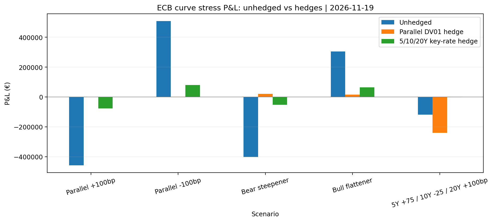

# Bond Pricing & Yield Curve Risk Engine

**Python · Fixed income · ECB yield curves · Duration & convexity · DV01 · Key-rate hedging**

A reproducible fixed-income analytics project that prices a synthetic four-bond portfolio using continuously compounded spot curves. It downloads the ECB AAA euro-area zero-coupon curve, measures portfolio sensitivity, sizes hypothetical zero-coupon hedges and stress-tests hedged and unhedged portfolios under parallel and nonparallel curve shocks.

> **Reference curve:** 19 November 2026 for the *archived* scenario results. This is an educational model, not an investment strategy or executable hedging recommendation.

## Interactive dashboard

[**Open the interactive risk dashboard**](dashboard/bond_risk_dashboard.html) (download the HTML file and open it in a browser; GitHub does not render the embedded interactive charts in its file preview). The HTML is self-contained and works offline.

## Key results

| Metric | Value |
| --- | ---: |
| Unhedged portfolio market value | **€7,003,525.81** |
| Unhedged total curve DV01 | **€4,816.59/bp** |
| Parallel hedge total curve DV01 | **€-0.0001/bp** |
| Parallel hedge absolute node DV01 | **€5,650.29/bp** |
| 5Y/10Y/20Y key-rate hedge residual DV01 | **€784.00/bp** |

In the hypothetical **5Y +75 bp / 10Y −25 bp / 20Y +100 bp** scenario, the unhedged portfolio loses **€118,116**, the parallel hedge loses **€240,049** and the key-rate hedge loses only **€386**. This illustrates how a parallel-DV01 hedge can fail to protect against particular nonparallel shifts.

## Research report

[**Download the fixed-income research report (PDF)**](reports/Bond_Yield_Curve_Risk_Research_Report.pdf)

## Repository structure

| Path | Description |
| --- | --- |
| `notebooks/bond_yield_curve_risk.ipynb` | Colab-ready pricing, ECB integration, risk measures, hedge sizing and scenario tests |
| `data/` | Archived bond, ECB curve, scenario, hedging and key-rate risk CSVs |
| `figures/` | Nine figures from the validated model calculations |
| `dashboard/bond_risk_dashboard.html` | Self-contained interactive Plotly charts for P&L and residual DV01 |
| `reports/Bond_Yield_Curve_Risk_Research_Report.pdf` | Research note covering methodology, results and limitations |
| `sources/SOURCES.md` | ECB links, modelling assumptions and data provenance |
| `requirements.txt` | Notebook dependencies |

## Run in Google Colab

1. Open `notebooks/bond_yield_curve_risk.ipynb` in [Google Colab](https://colab.research.google.com/).
2. Select **Runtime → Run all**. Internet access is required for the ECB API.
3. Inspect bond repricing, total and key-rate DV01, hedge positions, and stress P&L.
4. Download any fresh CSV or PNG files generated by the run.

The notebook is distributed without saved execution outputs, while **CSV tables and charts in this repository are frozen examples** generated from the 19 November 2026 ECB levels used in the user's completed Colab run. A future run may retrieve a different observation date and therefore produce different figures.

## Methodology

- **Prices:** PV of cash flows discounted with linear interpolation of the continuous spot curve.
- **Sensitivity:** symmetric 1 bp shifts; sum of node DV01 approximately equals total parallel-curve DV01.
- **Hedges:** signed short synthetic zero-coupon cash flows at 10Y (parallel hedge) or 5Y, 10Y, 20Y (key-rate hedge). No funding or trading costs modelled.
- **Stress:** exact repricing under parallel and maturity-specific constructed shifts.
- **Limitation:** duration neutrality does not mean curve neutrality; credit spreads, liquidity, funding, margin and executable quotes are excluded.

## Key takeaway

A single 10-year zero-coupon hedge nearly neutralizes parallel DV01, but can worsen P&L under specific curve rotations. The 5/10/20-year hedge removes the main selected node exposures, though other maturities remain sensitive.

**Educational analysis only, not financial advice.**
